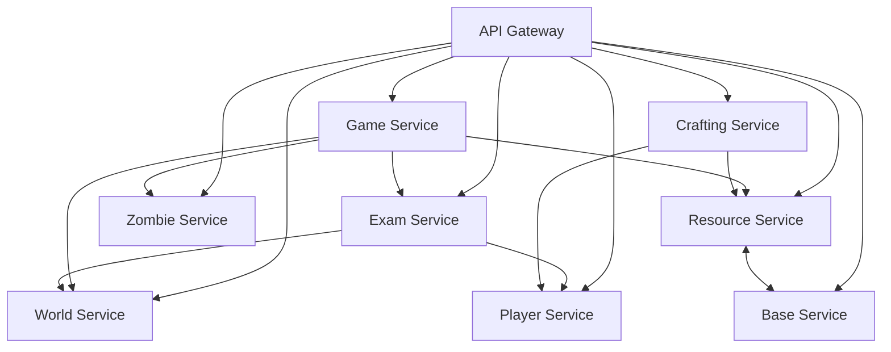

# Team 4 - Kahoots with the Undead

## Team Members
*To be filled in Team Definition Excel (Grade 2)*

## Project Overview
This is a microservices-based zombie survival game called "Kahoots with the Undead".

## Service Boundaries

### Player Service
- **Owns:** Registration, authentication, profiles, friends, XP/levels, inventory
- **Does not own:** Game sessions, exams, world state, resources directly

### Game Service
- **Owns:** Sessions/lobbies, day/night cycle, timers, timed actions (WebSockets), zombie behavior during a cycle
- **Does not own:** Map/world, inventory management, resources storage

### Exam Service
- **Owns:** Exams, attempts, grades, achievements
- **Emits:** `ExamPassed` event
- **Does not own:** Player XP directly, world unlocks directly

### World Service
- **Owns:** Campus map, rooms, resource nodes, zombie spawn points, unlocks wings
- **Does not own:** Player state, game sessions

### Zombie Service
- **Owns:** Zombie types (Professor, Tourist, custom), stats, configurations
- **Does not own:** Spawn logic coordination, game sessions

### Resource Service
- **Owns:** Resource quantities, idempotent apply/consume
- **Does not own:** Crafting recipes, player inventory (separate concern)

### Base Service
- **Owns:** Base state, upgrades, barricades, Kiki
- **Does not own:** Resource production, crafting

### Crafting Service
- **Owns:** Recipes, atomic crafting
- **Sends items to:** Player Service
- **Does not own:** Resource storage

## Architecture



## Technologies & Communication Patterns

| Service | Language/Framework | Communication Style | Justification & Trade-offs |
|---------|-------------------|-------------------|---------------------------|
| Player Service | TBD | REST | User data, auth - needs strong validation and consistency |
| Game Service | TBD (Node.js preferred) | WebSockets + REST | Real-time event loop ideal for concurrent connections and timed actions |
| Exam Service | TBD | REST + Events | Emits `ExamPassed` events to other services |
| World Service | TBD | REST | Map data, mostly static with updates |
| Zombie Service | TBD | REST | Zombie configs and stats |
| Resource Service | TBD | REST | Idempotent operations require strong transactional guarantees |
| Base Service | TBD | REST | Base state management |
| Crafting Service | TBD | REST | Atomic operations, complex validation |

*Team will decide specific languages (minimum 2 across team) in Team Definition.*

## Data Management
- **Database per service** pattern
- Services access each other's data **only through APIs/events**
- Possible DB choices: PostgreSQL (Player/Exam), MongoDB (World/Zombie), Redis (Game session state)

## Communication Contract

### API Endpoints

#### Player Service
```
POST /players/register
Request: { "username": "string", "email": "string", "password": "string" }
Response 200: { "playerId": "uuid", "token": "string" }

GET /players/:id
Response 200: { "playerId": "uuid", "username": "string", "level": "int", "xp": "int", "inventory": [] }
```

#### Resource Service
```
POST /resources/apply
Request: { "playerId": "uuid", "actionId": "uuid", "resource": "food", "amount": 12 }
Response 200: { "status": "applied", "newBalance": 40 }
Response 409: { "error": "action already applied" } // idempotency

POST /resources/consume
Request: { "playerId": "uuid", "actionId": "uuid", "resource": "wood", "amount": 5 }
Response 200: { "status": "consumed", "newBalance": 15 }
```

#### Exam Service
```
POST /exams/start
Request: { "playerId": "uuid", "examId": "uuid" }
Response 200: { "attemptId": "uuid", "questions": [] }

POST /exams/submit
Request: { "attemptId": "uuid", "answers": [] }
Response 200: { "passed": true, "score": 85 }
// Emits ExamPassed event if passed
```

#### Crafting Service
```
POST /craft/recipe/:recipeId
Request: { "playerId": "uuid", "actionId": "uuid" }
Response 200: { "status": "crafted", "item": {...} }
// Atomic: consumes resources, adds item to player
```

### WebSocket Messages (Game Service)
```json
{
  "type": "day_start|night_start|zombie_spawn|timer_update",
  "payload": {...}
}
```

### Events
- **ExamPassed**: `{ "eventType": "ExamPassed", "playerId": "uuid", "examId": "uuid", "timestamp": "ISO8601", "rewards": {...} }`
- **ActionCompleted**: `{ "eventType": "ActionCompleted", "actionId": "uuid", "playerId": "uuid", "result": {...} }`

## Contribution Guidelines

### Branches
- `main` - production branch
- `develop` - integration branch

### Branch Protection
- Require pull requests before merging
- Require at least 1-2 approvals
- No direct pushes to `main`

### Branch Naming
- `feature/<service-name>-<description>`
- `fix/<service-name>-<description>`
- `hotfix/<description>`

### Merge Strategy
- Squash and merge preferred

### PR Template
See `.github/pull_request_template.md`

### Commit Messages
Follow [Conventional Commits](https://www.conventionalcommits.org/)

### Test Coverage
Target: 70%

### Versioning
Semantic Versioning (SemVer) - tags like `v1.0.0`

