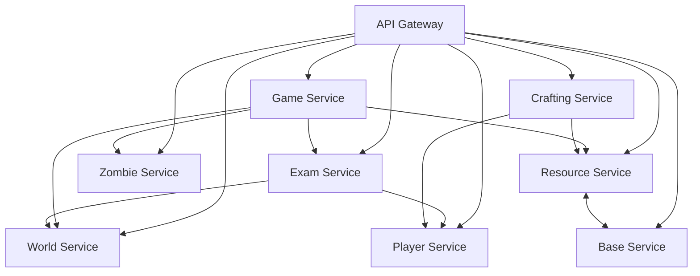

# Team 4 - Kahoots with the Undead

## Team Members
*To be filled in Team Definition Excel (Grade 2)*

## Project Overview
This is a microservices-based zombie survival game called "Kahoots with the Undead".

## Service Boundaries

### Player Service
- **Owns:** Registration, authentication, profiles, friends, XP/levels, inventory
- **Does not own:** Game sessions, exams, world state, resources directly

### Game Service
- **Owns:** Sessions/lobbies, day/night cycle, timers, timed actions (WebSockets), zombie behavior during a cycle
- **Does not own:** Map/world, inventory management, resources storage

### Exam Service
- **Owns:** Exams, attempts, grades, achievements
- **Emits:** `ExamPassed` event
- **Does not own:** Player XP directly, world unlocks directly

### World Service
- **Owns:** Campus map, rooms, resource nodes, zombie spawn points, unlocks wings
- **Does not own:** Player state, game sessions

### Zombie Service
- **Owns:** Zombie types (Professor, Tourist, custom), stats, configurations
- **Does not own:** Spawn logic coordination, game sessions

### Resource Service
- **Owns:** Resource quantities, idempotent apply/consume
- **Does not own:** Crafting recipes, player inventory (separate concern)

### Base Service
- **Owns:** Base state, upgrades, barricades, Kiki
- **Does not own:** Resource production, crafting

### Crafting Service
- **Owns:** Recipes, atomic crafting
- **Sends items to:** Player Service
- **Does not own:** Resource storage

## Architecture



## Technologies & Communication Patterns

| Service | Language/Framework | Communication Style | Justification & Trade-offs |
|---------|-------------------|-------------------|---------------------------|
| Player Service | Python (Flask) | REST | Auth and profile data require strong validation and transactional consistency; Flask + Pydantic models and async support fit. |
| Game Service | Node.js (Express + Socket.IO) | WebSockets + REST | Real-time day/night cycle, timers and concurrent connections suit the event loop; WebSockets for live updates. |
| Exam Service | Python (Flask) | REST + Events (RabbitMQ) | Exam attempts/grades need strong validation; emits `ExamPassed` event to World/Player via broker. |
| World Service | Node.js (Express) | REST | Map/room data mostly static with updates; lightweight JS service. |
| Zombie Service | Python (Flask) | REST | Zombie configs and stats; shares language with Player/Exam for consistency. |
| Resource Service | Python (Flask) | REST | Idempotent apply/consume requires strong transactional guarantees; Flask + SQLAlchemy. |
| Base Service | Node.js (Express) | REST | Base state and upgrades; shares language with Game/World. |
| Crafting Service | Python (Flask) | REST | Atomic crafting with complex validation; idempotent `actionId`. |

**Languages (2):** Python (Flask) and Node.js (Express). At least 2 languages across the team as required.

**Communication patterns:**
- Synchronous REST for queries/commands between services.
- WebSocket (Socket.IO) for Game Service real-time events (day/night, timers, zombie behavior).
- Message broker (RabbitMQ) for async events: `ExamPassed`, `ActionCompleted`, resource applied.

## Data Management
- **Database per service** pattern
- Services access each other's data **only through APIs/events**
- Possible DB choices: PostgreSQL (Player/Exam), MongoDB (World/Zombie), Redis (Game session state)


## Tooling

| Tool | Purpose |
|------|---------|
| Git | Version control |
| Docker Desktop | Container runtime for local stack |
| Python 3.12 | Service runtime (Flask) |
| Postman | API testing |
| PostgreSQL 16 | Per-service databases |

## Running locally
```bash
cp .env.example .env
docker compose up --build
```
Open http://localhost:5001/health and http://localhost:5002/health. Both should return `{"db":"up","status":"ok"}`. Import the Postman collections in `postman/`.

## Communication Contract

### Data Management
- **Database per service**: each service owns its own database; no shared tables.
- **Access through APIs/events only**: services never read each other's databases.
- **Databases**: PostgreSQL (Player, Exam, Resource, Base), MongoDB (World, Zombie, Crafting), Redis (Game session state).
- **Idempotency**: Resource and Crafting operations use `actionId` to prevent duplicate application.
- **Atomicity**: Crafting uses saga/transactional pattern across Resource + Player services.

### API Endpoints

#### Player Service
```
POST /players/register
Request:  { "username": "string", "email": "string", "password": "string" }
Response 201: { "playerId": "uuid", "token": "jwt" }
Response 409: { "error": "username or email already in use" }

POST /players/login
Request:  { "email": "string", "password": "string" }
Response 200: { "playerId": "uuid", "token": "jwt" }

GET /players/:id
Response 200: { "playerId": "uuid", "username": "string", "level": "int", "xp": "int", "inventory": ["itemId"] }

PUT /players/:id/xp
Request:  { "amount": "int", "reason": "string" }
Response 200: { "level": "int", "xp": "int" }

GET /players/:id/friends
Response 200: { "friends": ["playerId"] }

POST /players/:id/friends
Request:  { "friendId": "uuid" }
Response 201: { "status": "added" }

POST /players/:id/inventory
Request:  { "itemId": "uuid", "actionId": "uuid" }
Response 200: { "status": "added", "inventory": [...] }
```

#### Game Service
```
POST /games/sessions
Request:  { "hostId": "uuid", "maxPlayers": "int" }
Response 201: { "sessionId": "uuid", "code": "string" }

POST /games/sessions/:id/join
Request:  { "playerId": "uuid" }
Response 200: { "sessionId": "uuid", "players": ["playerId"] }

POST /games/sessions/:id/start
Response 200: { "status": "started", "cycle": "day|night" }

GET /games/sessions/:id
Response 200: { "sessionId": "uuid", "state": "lobby|active|ended", "cycle": "day|night", "timer": "int" }

POST /games/sessions/:id/action
Request:  { "playerId": "uuid", "actionId": "uuid", "action": "scavenge", "nodeId": "uuid", "duration": "int" }
Response 202: { "status": "started", "endsAt": "ISO8601" }
```

#### Exam Service
```
GET /exams
Response 200: { "exams": [{"examId": "uuid", "title": "string", "minLevel": "int"}] }

POST /exams/start
Request:  { "playerId": "uuid", "examId": "uuid" }
Response 200: { "attemptId": "uuid", "questions": [{"qid": "uuid", "text": "string"}] }

POST /exams/submit
Request:  { "attemptId": "uuid", "answers": [{"qid": "uuid", "answer": "string"}] }
Response 200: { "passed": "bool", "score": "int" }
// Emits ExamPassed event if passed

GET /exams/:id/achievements/:playerId
Response 200: { "achievements": [{"id": "uuid", "name": "string"}] }
```

#### World Service
```
GET /world/map
Response 200: { "rooms": [{"roomId": "uuid", "name": "string", "wing": "string", "unlocked": "bool"}], "nodes": [...], "spawns": [...] }

GET /world/rooms/:id
Response 200: { "roomId": "uuid", "name": "string", "wing": "string", "unlocked": "bool", "zombieSpawnPoints": ["uuid"] }

POST /world/rooms/:id/unlock
Request:  { "playerId": "uuid", "actionId": "uuid" }
Response 200: { "status": "unlocked", "room": {...} }

GET /world/nodes/:id
Response 200: { "nodeId": "uuid", "resource": "string", "amount": "int", "roomId": "uuid" }
```

#### Zombie Service
```
GET /zombies/types
Response 200: { "types": [{"typeId": "uuid", "name": "Professor|Tourist|Custom", "stats": {"hp": "int", "damage": "int", "speed": "int"}}] }

GET /zombies/types/:id
Response 200: { "typeId": "uuid", "name": "string", "stats": {...} }

POST /zombies/types
Request:  { "name": "string", "stats": {"hp": "int", "damage": "int", "speed": "int"} }
Response 201: { "typeId": "uuid" }
```

#### Resource Service
```
POST /resources/apply
Request:  { "playerId": "uuid", "actionId": "uuid", "resource": "food", "amount": 12 }
Response 200: { "status": "applied", "newBalance": 40 }
Response 409: { "error": "action already applied" }  // idempotency

POST /resources/consume
Request:  { "playerId": "uuid", "actionId": "uuid", "resource": "wood", "amount": 5 }
Response 200: { "status": "consumed", "newBalance": 15 }
Response 409: { "error": "action already processed" }

GET /resources/:playerId/balance
Response 200: { "balances": {"food": "int", "wood": "int", "metal": "int"} }
```

#### Base Service
```
GET /base/:playerId
Response 200: { "playerId": "uuid", "rooms": [...], "facilities": [...], "storageCapacity": "int", "kiki": {"present": "bool", "happiness": "int"} }

POST /base/upgrade
Request:  { "playerId": "uuid", "actionId": "uuid", "roomId": "string", "upgradeType": "string" }
Response 200: { "status": "upgraded", "cost": {...}, "newState": {...} }
Response 409: { "error": "insufficient resources" }

POST /base/barricade
Request:  { "playerId": "uuid", "actionId": "uuid", "roomId": "string" }
Response 200: { "status": "barricaded", "resourcesConsumed": {...} }

POST /base/kiki/interact
Request:  { "playerId": "uuid", "actionId": "uuid" }
Response 200: { "reward": {...}, "type": "booster|item" }
```

#### Crafting Service
```
GET /craft/recipes
Query:    ?playerId=uuid
Response 200: { "recipes": [{"recipeId": "uuid", "name": "string", "ingredients": [{"resource": "string", "amount": "int"}], "result": {...}, "unlocked": "bool"}] }

GET /craft/recipes/:recipeId
Response 200: { "recipeId": "uuid", "name": "string", "ingredients": [...], "result": {...}, "requirements": {...} }

POST /craft/recipe/:recipeId
Request:  { "playerId": "uuid", "actionId": "uuid" }
Response 200: { "status": "crafted", "item": {...}, "inventoryUpdated": "bool" }
Response 400: { "error": "missing materials" }
Response 403: { "error": "recipe locked" }
Response 409: { "error": "action already processed" }
```

### WebSocket Messages (Game Service)
```json
{
  "type": "day_start|night_start|zombie_spawn|timer_update|action_complete",
  "payload": { "sessionId": "uuid", "timer": "int", "zombies": [...] }
}
```

### Events (via RabbitMQ)
- **ExamPassed**: `{ "eventType": "ExamPassed", "playerId": "uuid", "examId": "uuid", "timestamp": "ISO8601", "rewards": {...} }`
- **ActionCompleted**: `{ "eventType": "ActionCompleted", "actionId": "uuid", "playerId": "uuid", "result": {...} }`
- **ResourceApplied**: `{ "eventType": "ResourceApplied", "playerId": "uuid", "actionId": "uuid", "resource": "string", "amount": "int", "newBalance": "int" }`

## Contribution Guidelines
## Contribution Guidelines

### Branches
- `main` - production branch
- `develop` - integration branch

### Branch Protection
- Require pull requests before merging
- Require at least 1-2 approvals
- No direct pushes to `main`

### Branch Naming
- `feature/<service-name>-<description>`
- `fix/<service-name>-<description>`
- `hotfix/<description>`

### Merge Strategy
- Squash and merge preferred

### PR Template
See `.github/pull_request_template.md`

### Commit Messages
Follow [Conventional Commits](https://www.conventionalcommits.org/)

### Test Coverage
Target: 70%

### Versioning
Semantic Versioning (SemVer) - tags like `v1.0.0`

