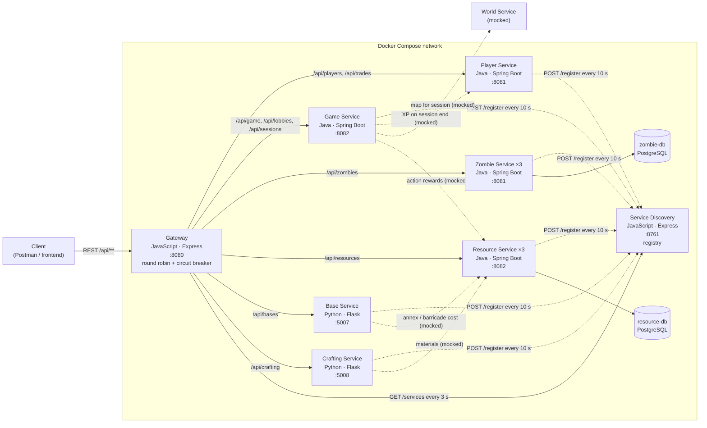

# Architecture

Paste this into the CPR README (GitHub renders Mermaid blocks automatically).

- Solid arrows: implemented HTTP calls. Dotted arrows from game/base/crafting: service-to-service calls that are mocked for now.
- Lab 3: every service registers with the Service Discovery on startup (`POST /register`) and every 10 s (heartbeat). The gateway balances over the registered instances (round robin); its circuit breaker logs an ERROR when one instance fails 3 times within `UPSTREAM_TIMEOUT_MS * 3.5`.
- zombie-service and resource-service run 3 replicas each (state in PostgreSQL); the in-memory services run one instance.
- Only the gateway publishes a port to the host; the services and databases are reachable only inside the compose network.
- Database per service: zombie-service and resource-service each own a PostgreSQL container and volume.
- The Game Service validates JWTs issued by the Player Service with the shared `JWT_SECRET`.

